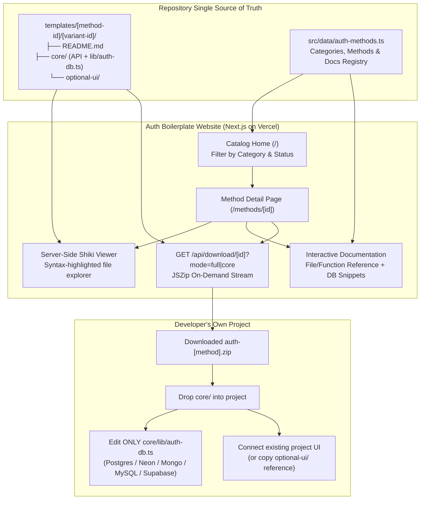

<p align="center">
  
</p>

<h1 align="center">Auth Boilerplate</h1>

<p align="center">
  Production-ready, database-agnostic authentication boilerplates with Shiki code previews, architecture docs, and one-click ZIP downloads.
</p>

<p align="center">
  
  
  
  
  
  
  
</p>

> 🚧 **Work in progress.** Auth Boilerplate is an open catalog of **17 authentication methods** across **5 categories** (`Credentials`, `Passwordless`, `Social`, `Modern`, and `Enterprise SSO`). Rather than locking developers into a third-party auth vendor or forcing a rigid UI and database, every method provides a clean `core/` backend implementation with a single-file database adapter (`auth-db.ts`), optional reference UI wiring (`optional-ui/`), interactive Shiki code highlighting, function-level documentation, and one-click `.zip` downloads. Follow the [roadmap](#roadmap) below for commit-by-commit progress.

## Table of contents

- [Overview](#overview)
- [Roadmap](#roadmap)
- [Tech stack](#tech-stack)
- [Project structure](#project-structure)
- [Architecture](#architecture)
- [Template design (DB-agnostic & optional UI)](#template-design-db-agnostic--optional-ui)
- [Authentication catalog](#authentication-catalog)
- [API routes](#api-routes)
- [Getting started](#getting-started)
- [Contributing](#contributing)

## Overview

**Auth Boilerplate** helps developers integrate authentication into their own projects without vendor lock-in. Users browse the catalog of 17 authentication methods, inspect the syntax-highlighted source files directly in the browser, read the file-by-file and function-by-function documentation, and download a self-contained `.zip` archive complete with a tailored `README.md` setup guide.

**Core platform principles**

- **Zero Platform Database Overhead:** The Auth Boilerplate website itself uses no database and runs 100% free on Vercel. All catalog metadata, documentation, and template source files live directly in the repository.
- **Single Source of Truth (`templates/`):** The raw files inside `templates/[method-id]/[variant-id]/` power both the browser Shiki code viewer and the downloadable `.zip` bundle.
- **Database-Agnostic via Adapter Pattern:** Downloaded auth code never hardcodes database queries inside API routes. All database reads/writes are isolated inside `core/lib/auth-db.ts`, with copy-paste snippets in each template's `README.md` for **Neon / PostgreSQL**, **MongoDB**, **MySQL**, and **Supabase**.
- **Headless Core + Optional Reference UI:** Every downloadable template separates `core/` (required API routes, session/token helpers, and DB adapter) from `optional-ui/` (reference hooks and minimal forms) so developers can easily wire their own project's theme and components.
- **Multi-Variant Ready:** The data schema supports multiple implementation variants per method (starting with `nextjs-app-router` as the flagship variant, with room for Express, Fastify, or Hono variants later).

## Roadmap

This README doubles as the project's commit-by-commit progress tracker. Update the relevant checklist in the same commit that completes a step.

`[x]` completed · `[ ]` pending

### At a glance

| Phase | Focus | Status |
|:-----:|-------|--------|
| 1 | Foundation, registry & extensible schema | ✅ Complete |
| 2 | Global layout, hero & catalog UI | ✅ Complete |
| 3 | Method detail page, Shiki viewer & docs UI | ✅ Complete |
| 4 | `.zip` bundler & download pipeline | ✅ Complete |
| 5 | Credentials auth boilerplates (3 methods) | 🚧 In progress |
| 6 | Passwordless auth boilerplates (3 methods) | ⏳ Planned |
| 7 | Social OAuth boilerplates (7 methods) | ⏳ Planned |
| 8 | Modern auth boilerplates (2 methods) | ⏳ Planned |
| 9 | Enterprise SSO boilerplates (2 methods) | ⏳ Planned |
| 10 | Command palette search, SEO & release polish | ⏳ Planned |

---

### Phase 1 — Foundation, registry & extensible schema ✅

- [x] **Step 1.1:** Initialize Next.js App Router with TypeScript, Tailwind CSS, `lucide-react`, `shiki`, and `jszip`
- [x] **Step 1.2:** Add `src/data/auth-methods.ts` with the 5 `authCategories`, 17 `authMethods`, and lookup helpers (`getAuthMethodById`, `getAuthMethodsByCategory`)
- [x] **Step 1.3:** Create `src/types/auth.ts` with types for `AuthVariant`, `TemplateFile` (`core` vs `optional-ui` vs `db-adapter` badges), `FunctionDoc`, `DbAdapterMethodDoc`, and `ApiPayloadContract`
- [x] **Step 1.4:** Create `src/lib/templates.ts` to read raw files from `templates/[method-id]/[variant-id]/` on the server and construct the structured file tree

### Phase 2 — Global layout, hero & catalog UI ✅

- [x] **Step 2.1:** Create a dark developer-focused layout with sticky navigation, GitHub link, and quick category jump links
- [x] **Step 2.2:** Create the hero section explaining the `core/` + `auth-db.ts` + `optional-ui/` workflow and one-click `.zip` downloads
- [x] **Step 2.3:** Build filter controls for `All`, `Credentials`, `Passwordless`, `Social`, `Modern`, and `Enterprise SSO`, plus status pills (`available`, `in-progress`, `planned`)
- [x] **Step 2.4:** Render all 17 authentication methods with dynamic Lucide icons, category tags, status badges, and links to `/methods/[id]`

### Phase 3 — Method detail page, Shiki viewer & docs UI ✅

- [x] **Step 3.1:** Build the method detail header with breadcrumbs, status badge, variant selector dropdown (`Next.js App Router`), and primary **Download `.zip`** CTA
- [x] **Step 3.2:** Create `src/lib/shiki.ts` singleton and render syntax-highlighted source files with zero client-side syntax bundle overhead
- [x] **Step 3.3:** Build an interactive file explorer with **horizontal** tabs and a single active **Shiki-highlighted** code preview for switching between template files.
- [x] **Step 3.4:** Group template files into `README.md`, `core/` (Required), `core/lib/auth-db.ts` (DB Adapter highlight), and `optional-ui/` (Optional Reference UI) with one-click file copy
- [x] **Step 3.5:** Render structured documentation explaining what each file and function does, required environment variables, and security notes
- [x] **Step 3.6:** Add interactive tabs showing drop-in `auth-db.ts` implementations for **PostgreSQL (Neon)**, **MongoDB**, **MySQL**, and **Supabase**, plus the JSON request/response contract for custom UIs

### Phase 4 — `.zip` bundler & download pipeline ✅

- [x] **Step 4.1:** Use `jszip` in a Next.js Route Handler to package `templates/[method-id]/[variant-id]/` (including `README.md`, `core/`, and `optional-ui/`) and stream `auth-[method-id].zip`
- [x] **Step 4.2:** Allow developers to download either the **Full Package (`core/` + `optional-ui/` + `README.md`)** or **Headless Core Only (`core/` + `README.md`)**

### Phase 5 — Credentials auth boilerplates 🚧

- [x] **Step 5.1:** Implement password hashing (Web Crypto PBKDF2/Scrypt), stateless HTTP-only JWT sessions (`jose`), register/login/logout/me API routes, `auth-db.ts` adapter, optional reference forms, and `README.md`; mark `email-password` as `available`
- [x] **Step 5.2:** Add database adapter documentation and UI for **Neon**, **MongoDB**, **MySQL**, and **Supabase**, with **Neon** as implemented and the remaining adapters as reference examples; add syntax-highlighted adapter tabs, integrate the database adapter section into the `Email & Password` method detail page, and improve the template file explorer and file overview.
- [x] **Step 5.3:** Implement username normalization, uniqueness checks, login/register/logout routes, `auth-db.ts` adapter, optional UI, and `README.md`; mark `username-password` as `available`
- [ ] **Step 5.4:** Add File Overview, database adapter documentation, and API contracts to the `Username & Password` method detail page.
- [ ] **Step 5.5:** Implement E.164 phone normalization, password authentication routes, `auth-db.ts` adapter, optional UI, and `README.md`; mark `phone-password` as `available`

### Phase 6 — Passwordless auth boilerplates ⏳

- [ ] **Step 6.1:** Implement cryptographic 6-digit OTP generation, hashed OTP storage, rate/expiry verification, pluggable email sender helper (`core/lib/mailer.ts`), `auth-db.ts`, and `README.md`; mark `email-otp` as `available`
- [ ] **Step 6.2:** Implement single-use signed/hashed token generation, callback verification route, pluggable email sender, `auth-db.ts`, and `README.md`; mark `magic-link` as `available`
- [ ] **Step 6.3:** Implement SMS OTP issue/verify routes, pluggable SMS provider adapter (`core/lib/sms.ts` for Twilio/Vonage/console), `auth-db.ts`, and `README.md`; mark `sms-otp` as `available`

### Phase 7 — Social OAuth boilerplates ⏳

- [ ] **Step 7.1:** Implement OAuth 2.0 authorization redirect, PKCE + CSRF state cookie validation, token exchange, account linking in `auth-db.ts`, and `README.md`; mark `google-oauth` as `available`
- [ ] **Step 7.2:** Implement GitHub OAuth redirect, callback handler, primary verified email fetch, `auth-db.ts` adapter, and `README.md`; mark `github-oauth` as `available`
- [ ] **Step 7.3:** Implement Discord OAuth2 flow, user profile hydration, `auth-db.ts` adapter, and `README.md`; mark `discord-oauth` as `available`
- [ ] **Step 7.4:** Implement Microsoft Entra / common tenant OAuth2 flow, token exchange, `auth-db.ts` adapter, and `README.md`; mark `microsoft-oauth` as `available`
- [ ] **Step 7.5:** Implement Sign in with Apple client secret JWT generation, `form_post` callback handling, ID token verification, `auth-db.ts`, and `README.md`; mark `apple-oauth` as `available`
- [ ] **Step 7.6:** Implement Facebook Graph OAuth flow, callback verification, `auth-db.ts` adapter, and `README.md`; mark `facebook-oauth` as `available`
- [ ] **Step 7.7:** Implement X (Twitter) OAuth 2.0 with PKCE flow, user lookup, `auth-db.ts` adapter, and `README.md`; mark `x-oauth` as `available`

### Phase 8 — Modern auth boilerplates ⏳

- [ ] **Step 8.1:** Implement WebAuthn registration & authentication challenge generation, credential public key verification (`@simplewebauthn/server`), `auth-db.ts` passkey store, and `README.md`; mark `passkeys` as `available`
- [ ] **Step 8.2:** Implement temporary anonymous session creation and account promotion/linking helper in `auth-db.ts` + `README.md`; mark `guest-login` as `available`

### Phase 9 — Enterprise SSO boilerplates ⏳

- [ ] **Step 9.1:** Implement dynamic OIDC `.well-known/openid-configuration` discovery, domain-based tenant lookup, ID token validation, `auth-db.ts`, and `README.md`; mark `oidc-sso` as `available`
- [ ] **Step 9.2:** Implement SP-initiated login redirect, Assertion Consumer Service (ACS) XML signature verification, attribute mapping, `auth-db.ts`, and `README.md`; mark `saml-sso` as `available`

### Phase 10 — Command palette search, SEO & release polish ⏳

- [ ] **Step 10.1:** Build instant keyboard-accessible search across all 17 auth methods, categories, and documentation topics
- [ ] **Step 10.2:** Add a build-time check ensuring every `available` method has valid files in `templates/`, a complete `README.md`, and working `.zip` packaging
- [ ] **Step 10.3:** Add dynamic OpenGraph metadata per method page, responsive mobile polish, and final production build verification

---

## Tech stack

### 1. The Auth Boilerplate Platform (This Website)

| Layer | Technology | Purpose |
|-------|------------|---------|
| Framework | Next.js (App Router) | Server Components for zero-bundle code rendering & API routes for `.zip` streaming |
| Language | TypeScript | Strict typing across the method registry, documentation blocks, and templates |
| Styling | Tailwind CSS | Responsive developer-focused dark UI |
| Syntax Highlighting | Shiki | Server-side syntax highlighting (`codeToHtml`) with VS Code theme accuracy |
| Icons | `lucide-react` | Category, method, and file-tree iconography |
| Brand Icons | `react-icons` | Official social provider logos for authentication methods |
| Archive Bundler | `jszip` | On-demand `.zip` generation directly from the `templates/` directory |
| Hosting | Vercel (Free Hobby Tier) | Stateless deployment with zero database required |

### 2. The Downloadable Auth Templates (Inside Each `.zip`)

| Layer | Technology | Purpose |
|-------|------------|---------|
| HTTP Handlers | Next.js App Router Route Handlers | Clean `POST`/`GET` endpoints under `app/api/auth/...` |
| Session & Tokens | `jose` + Web Crypto API | Edge-compatible stateless `httpOnly` JWT sessions, CSRF state, and hashing |
| Database Layer | Single-file `core/lib/auth-db.ts` | Adapter pattern with ready-to-paste snippets for **PostgreSQL (Neon)**, **MongoDB**, **MySQL**, and **Supabase** |
| Optional UI | React + Tailwind CSS (Optional) | Minimal reference hooks & unopinionated forms showing how to connect any UI |

## Project structure

```text
auth-boilerplate/
├── public/
│   └── logo.svg
├── src/
│   ├── app/
│   │   ├── api/
│   │   │   └── download/
│   │   │       └── [id]/
│   │   │           └── route.ts         # Streams the .zip package for a given auth method
│   │   ├── methods/
│   │   │   └── [id]/
│   │   │       └── page.tsx             # Method detail page (Shiki viewer + Architecture Docs)
│   │   ├── globals.css
│   │   ├── layout.tsx                   # Global shell & navbar
│   │   └── page.tsx                     # Catalog home with category filters & search
│   ├── components/
│   │   ├── catalog/
│   │   │   ├── CategoryTabs.tsx
│   │   │   └── MethodCard.tsx
│   │   ├── method-detail/
│   │   │   ├── CodeExplorer.tsx         # File tree + Shiki code panel + Copy button
│   │   │   ├── DbAdapterTabs.tsx        # Postgres/Neon, Mongo, MySQL, Supabase switcher
│   │   │   ├── DownloadButton.tsx       # Triggers full or core-only .zip download
│   │   │   └── FunctionDocs.tsx         # Explains every file, function, and API payload
│   │   └── layout/
│   │       ├── Navbar.tsx
│   │       └── CommandMenu.tsx          # Ctrl+K search modal
│   ├── data/
│   │   ├── auth-methods.ts              # 5 categories & 17 auth methods registry
│   │   └── method-docs/                 # Structured documentation & DB adapter snippets per method
│   ├── lib/
│   │   ├── shiki.ts                     # Shiki highlighter singleton
│   │   └── templates.ts                 # Reads raw files from templates/ for UI & ZIP
│   └── types/
│       └── auth.ts                      # Types for categories, methods, variants & docs
├── templates/                           # Single source of truth for viewable & downloadable code
│   ├── email-password/
│   │   └── nextjs-app-router/           # Default flagship variant
│   │       ├── README.md                # Step-by-step integration & DB setup instructions
│   │       ├── core/                    # REQUIRED: Headless backend auth logic
│   │       │   ├── api/auth/...         # Route handlers (login, register, logout, me)
│   │       │   └── lib/
│   │       │       ├── auth-db.ts       # <-- The ONLY file users edit for their database
│   │       │       ├── password.ts      # Cryptographic hashing & verification
│   │       │       └── session.ts       # Stateless httpOnly cookie session manager
│   │       └── optional-ui/             # OPTIONAL: Reference client wiring & minimal form
│   │           ├── use-auth.ts
│   │           └── AuthFormExample.tsx
│   └── ... (all 17 methods)
└── README.md
```

## Architecture



## Template design (DB-agnostic & optional UI)

Every project has its own UI design system and its own database choice. To make every boilerplate universal with minimal changes, each method's template is divided into two clear parts:

### 1. `core/` (Required Headless Auth Engine)
Contains all Next.js API route handlers, token/session cryptography, and `core/lib/auth-db.ts`.
- **No Database Lock-In:** Route handlers never import `pg`, `mongoose`, `mysql2`, or `@supabase/supabase-js` directly. Instead, they call typed functions on `authDb` (such as `authDb.findUserByEmail(email)` or `authDb.createUser(data)`).
- **One File to Edit:** Developers only open `core/lib/auth-db.ts` and paste the snippet for their database from the included `README.md` (with ready-made implementations for **Neon Serverless Postgres**, **MongoDB**, **MySQL**, and **Supabase**).

### 2. `optional-ui/` (Optional Reference Wiring)
Because every application has its own theme and component library, UI files are strictly optional.
- Developers can either download the **Core-Only `.zip`** and connect their existing forms to the documented JSON endpoints, or inspect `optional-ui/` to see a clean `fetch()` hook and minimal form example.

## Authentication catalog

All 17 methods defined in `src/data/auth-methods.ts`:

| Category | ID | Method Title | Status |
|----------|----|--------------|:------:|
| **Credentials** | `email-password` | Email & Password | ✅ Available |
| **Credentials** | `username-password` | Username & Password | ✅ Available |
| **Credentials** | `phone-password` | Phone & Password | ⏳ Planned |
| **Passwordless** | `email-otp` | Email OTP | ⏳ Planned |
| **Passwordless** | `magic-link` | Magic Link | ⏳ Planned |
| **Passwordless** | `sms-otp` | Phone / SMS OTP | ⏳ Planned |
| **Social** | `google-oauth` | Google Login | ⏳ Planned |
| **Social** | `github-oauth` | GitHub Login | ⏳ Planned |
| **Social** | `discord-oauth` | Discord Login | ⏳ Planned |
| **Social** | `microsoft-oauth` | Microsoft Login | ⏳ Planned |
| **Social** | `apple-oauth` | Apple Login | ⏳ Planned |
| **Social** | `facebook-oauth` | Facebook Login | ⏳ Planned |
| **Social** | `x-oauth` | X (Twitter) Login | ⏳ Planned |
| **Modern** | `passkeys` | Passkeys / WebAuthn | ⏳ Planned |
| **Modern** | `guest-login` | Guest / Anonymous Login | ⏳ Planned |
| **Enterprise** | `oidc-sso` | OIDC Single Sign-On | ⏳ Planned |
| **Enterprise** | `saml-sso` | SAML 2.0 Single Sign-On | ⏳ Planned |

## API routes

### Platform API Routes (Auth Boilerplate Website)

| Route | Method | Description |
|-------|--------|-------------|
| `/api/download/[id]` | `GET` | Packages `templates/[id]/[variant]` into a `.zip` stream. Supports `?variant=nextjs-app-router` and `?includeUi=true\|false`. |

## Getting started

### Prerequisites

- Node.js 20 or later
- `pnpm` (or `npm` / `bun`)

### 1. Clone the repository

```bash
git clone https://github.com/<your-username>/auth-boilerplate.git
cd auth-boilerplate
```

### 2. Install dependencies

```bash
pnpm install
```

No `.env` file or database is required to run the **Auth Boilerplate** website locally.

### 3. Run the development server

```bash
pnpm dev
```

Open [http://localhost:3000](http://localhost:3000) in your browser.

### 4. Type-check and verify build

```bash
pnpm exec tsc --noEmit
pnpm build
```

## Contributing

We follow a strict commit-by-commit flow matching the [Roadmap](#roadmap):
1. Pick the next unchecked step (`[ ]`) in the active phase.
2. Implement the files for that step and verify with `tsc --noEmit`.
3. Mark the step as `[x]` in `README.md` inside the exact same commit.
4. Commit using the conventional commit message listed in the roadmap step.
