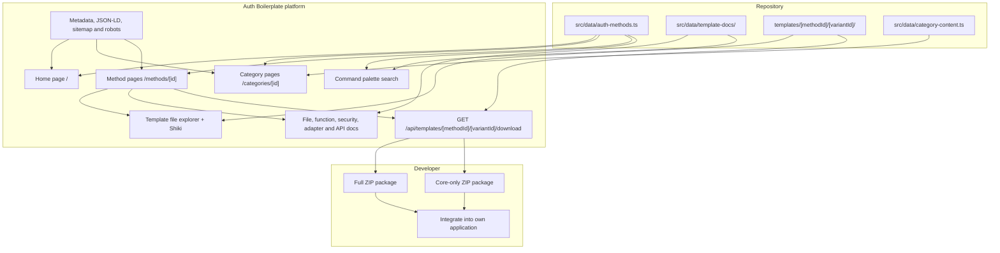

<p align="center">
  
</p>

<h1 align="center">Auth Boilerplate</h1>

<p align="center">
  Production-ready, database-agnostic authentication boilerplates with Shiki code previews, architecture docs, and one-click ZIP downloads.
</p>

<p align="center">
  
  
  
  
  
  
  
</p>

> **Auth Boilerplate** is a catalog of 17 reusable authentication implementations across five categories: Credentials, Passwordless, Social, Modern, and Enterprise SSO. Explore each method, inspect its source code and implementation notes, compare documented database adapter examples, and download a ready-to-integrate ZIP package. The platform is a code catalog and download experience—not a hosted authentication service.

## Table of contents

- [Overview](#overview)
- [Roadmap](#roadmap)
- [Tech stack](#tech-stack)
- [Project structure](#project-structure)
- [Architecture](#architecture)
- [Template design (DB-agnostic & optional UI)](#template-design-db-agnostic--optional-ui)
- [Authentication catalog](#authentication-catalog)
- [API routes](#api-routes)
- [Getting started](#getting-started)
- [Contributing](#contributing)

## Overview

**Auth Boilerplate** helps developers explore and integrate authentication implementations into their own applications. The website provides:

- A catalog of 17 authentication methods grouped into five dedicated category pages.
- Individual method pages with source-file browsing and server-rendered Shiki syntax highlighting.
- Structured documentation covering files, functions, environment variables, security considerations, database adapter examples, and API request/response contracts.
- Full-package and headless-core ZIP downloads for each available method and implementation variant.
- Keyboard-accessible catalog search across authentication methods, categories, and documentation topics.

**Platform principles**

- **No platform database:** The catalog registry and documentation are stored in the repository. The website does not require an application database or authentication-provider credentials to run.
- **Repository-backed templates:** The root `templates/[methodId]/[variantId]/` directory is the source read by the server-side file loader and ZIP download handler.
- **Inspectable implementations:** Users can inspect template files before downloading and review method-specific integration documentation.
- **Optional reference UI:** Where included, `optional-ui/` provides example client-side wiring. The headless package can be selected when developers want to connect their own UI.
- **Extensible variants:** The registry and template loader support variant directories. `nextjs-app-router` is the current implementation variant represented in the catalog.
- **Not an authentication SaaS:** Auth Boilerplate does not create user accounts, manage application sessions, or authenticate visitors on behalf of developers. Those responsibilities belong to the downloaded implementation and the developer's application.

## Roadmap

This README doubles as the project's commit-by-commit progress tracker. Update the relevant checklist in the same commit that completes a step.

`[x]` completed · `[ ]` pending

### At a glance

| Phase | Focus | Status |
|:-----:|-------|--------|
| 1 | Foundation, registry & extensible schema | ✅ Complete |
| 2 | Global layout, hero & catalog UI | ✅ Complete |
| 3 | Method detail page, Shiki viewer & docs UI | ✅ Complete |
| 4 | `.zip` bundler & download pipeline | ✅ Complete |
| 5 | Credentials auth boilerplates (3 methods) | ✅ Complete |
| 6 | Passwordless auth boilerplates (3 methods) | ✅ Complete  |
| 7 | Social OAuth boilerplates (7 methods) | ✅ Complete |
| 8 | Modern auth boilerplates (2 methods) | ✅ Complete |
| 9 | Enterprise SSO boilerplates (2 methods) | ✅ Complete |
| 10 | Command palette search, SEO & release polish | ✅ Complete |

---

### Phase 1 — Foundation, registry & extensible schema ✅

- [x] **Step 1.1:** Initialize Next.js App Router with TypeScript, Tailwind CSS, `lucide-react`, `shiki`, and `jszip`
- [x] **Step 1.2:** Add `src/data/auth-methods.ts` with the 5 `authCategories`, 17 `authMethods`, and lookup helpers (`getAuthMethodById`, `getAuthMethodsByCategory`)
- [x] **Step 1.3:** Create `src/types/auth.ts` with types for `AuthVariant`, `TemplateFile` (`core` vs `optional-ui` vs `db-adapter` badges), `FunctionDoc`, `DbAdapterMethodDoc`, and `ApiPayloadContract`
- [x] **Step 1.4:** Create `src/lib/templates.ts` to read raw files from `templates/[method-id]/[variant-id]/` on the server and construct the structured file tree

### Phase 2 — Global layout, hero & catalog UI ✅

- [x] **Step 2.1:** Create a dark developer-focused layout with sticky navigation, GitHub link, and quick category jump links
- [x] **Step 2.2:** Create the hero section explaining the `core/` + `auth-db.ts` + `optional-ui/` workflow and one-click `.zip` downloads
- [x] **Step 2.3:** Build filter controls for `All`, `Credentials`, `Passwordless`, `Social`, `Modern`, and `Enterprise SSO`, plus status pills (`available`, `in-progress`, `planned`)
- [x] **Step 2.4:** Render all 17 authentication methods with dynamic Lucide icons, category tags, status badges, and links to `/methods/[id]`

### Phase 3 — Method detail page, Shiki viewer & docs UI ✅

- [x] **Step 3.1:** Build the method detail header with breadcrumbs, status badge, variant selector dropdown (`Next.js App Router`), and primary **Download `.zip`** CTA
- [x] **Step 3.2:** Create `src/lib/shiki.ts` singleton and render syntax-highlighted source files with zero client-side syntax bundle overhead
- [x] **Step 3.3:** Build an interactive file explorer with **horizontal** tabs and a single active **Shiki-highlighted** code preview for switching between template files.
- [x] **Step 3.4:** Group template files into `README.md`, `core/` (Required), `core/lib/auth-db.ts` (DB Adapter highlight), and `optional-ui/` (Optional Reference UI) with one-click file copy
- [x] **Step 3.5:** Render structured documentation explaining what each file and function does, required environment variables, and security notes
- [x] **Step 3.6:** Add interactive tabs showing drop-in `auth-db.ts` implementations for **PostgreSQL (Neon)**, **MongoDB**, **MySQL**, and **Supabase**, plus the JSON request/response contract for custom UIs

### Phase 4 — `.zip` bundler & download pipeline ✅

- [x] **Step 4.1:** Use `jszip` in a Next.js Route Handler to package `templates/[method-id]/[variant-id]/` (including `README.md`, `core/`, and `optional-ui/`) and stream `auth-[method-id].zip`
- [x] **Step 4.2:** Allow developers to download either the **Full Package (`core/` + `optional-ui/` + `README.md`)** or **Headless Core Only (`core/` + `README.md`)**

### Phase 5 — Credentials auth boilerplates ✅

- [x] **Step 5.1:** Implement password hashing (Web Crypto PBKDF2/Scrypt), stateless HTTP-only JWT sessions (`jose`), register/login/logout/me API routes, `auth-db.ts` adapter, optional reference forms, and `README.md`; mark `email-password` as `available`
- [x] **Step 5.2:** Add database adapter documentation and UI for **Neon**, **MongoDB**, **MySQL**, and **Supabase**, with **Neon** as implemented and the remaining adapters as reference examples; add syntax-highlighted adapter tabs, integrate the database adapter section into the `Email & Password` method detail page, and improve the template file explorer and file overview.
- [x] **Step 5.3:** Implement username normalization, uniqueness checks, login/register/logout routes, `auth-db.ts` adapter, optional UI, and `README.md`; mark `username-password` as `available`
- [x] **Step 5.4:** Add File Overview, database adapter documentation, and API contracts to the `Username & Password` method detail page.
- [x] **Step 5.5:** Implement E.164 phone normalization, password authentication routes, `auth-db.ts` adapter, optional UI, and `README.md`; mark `phone-password` as `available`
- [x] **Step 5.6:** Add File Overview, database adapter documentation, and API contracts to the `Phone & Password` method detail page.
- [x] **Step 5.7:** Improve the shared template UI by enhancing the file explorer, adding **Markdown rendering** for `README.md` files, refining code display and text wrapping.

### Phase 6 — Passwordless auth boilerplates ✅

- [x] **Step 6.1:** Implement cryptographic 6-digit OTP generation, hashed OTP storage, rate/expiry verification, pluggable email sender helper (`core/lib/mailer.ts`), `auth-db.ts`, and `README.md`; mark `email-otp` as `available`
- [x] **Step 6.2:** Add File Overview, database adapter documentation, and API contracts to the `Email OTP` method detail page; integrate the optional reference UI and database adapter section.
- [x] **Step 6.3:** Implement single-use signed/hashed token generation, callback verification route, pluggable email sender, `auth-db.ts`, and `README.md`; mark `magic-link` as `available`
- [x] **Step 6.4:** Add File Overview, database adapter documentation, and API contracts to the `Magic Link` method detail page.
- [x] **Step 6.5:** Implement SMS OTP issue/verify routes, pluggable SMS provider adapter (`core/lib/sms.ts` for Twilio/Vonage/console), `auth-db.ts`, and `README.md`; mark `sms-otp` as `available`
- [x] **Step 6.6:** Add File Overview, database adapter documentation, and API contracts to the `SMS OTP` method detail page.

### Phase 7 — Social OAuth boilerplates ✅

- [x] **Step 7.1:** Implement OAuth 2.0 authorization redirect, PKCE + CSRF state cookie validation, token exchange, account linking in `auth-db.ts`, and `README.md`; mark `google-oauth` as `available`
- [x] **Step 7.2:** Implement GitHub OAuth redirect, callback handler, primary verified email fetch, `auth-db.ts` adapter, and `README.md`; mark `github-oauth` as `available`
- [x] **Step 7.3:** Implement Discord OAuth2 flow, user profile hydration, `auth-db.ts` adapter, and `README.md`; mark `discord-oauth` as `available`
- [x] **Step 7.4:** Implement Microsoft Entra / common tenant OAuth2 flow, token exchange, `auth-db.ts` adapter, and `README.md`; mark `microsoft-oauth` as `available`
- [x] **Step 7.5:** Implement Sign in with Apple client secret JWT generation, `form_post` callback handling, ID token verification, `auth-db.ts`, and `README.md`; mark `apple-oauth` as `available`
- [x] **Step 7.6:** Implement Facebook Graph OAuth flow, callback verification, `auth-db.ts` adapter, and `README.md`; mark `facebook-oauth` as `available`
- [x] **Step 7.7:** Implement X (Twitter) OAuth 2.0 with PKCE flow, user lookup, `auth-db.ts` adapter, and `README.md`; mark `x-oauth` as `available`

### Phase 8 — Modern auth boilerplates ✅

- [x] **Step 8.1:** Implement WebAuthn registration & authentication challenge generation, credential public key verification (`@simplewebauthn/server`), `auth-db.ts` passkey store, and `README.md`; mark `passkeys` as `available`
- [x] **Step 8.2:** Implement temporary anonymous session creation and account promotion/linking helper in `auth-db.ts` + `README.md`; mark `guest-login` as `available`

### Phase 9 — Enterprise SSO boilerplates ✅

- [x] **Step 9.1:** Implement dynamic OIDC `.well-known/openid-configuration` discovery, domain-based tenant lookup, ID token validation, `auth-db.ts`, and `README.md`; mark `oidc-sso` as `available`
- [x] **Step 9.2:** Implement SP-initiated login redirect, Assertion Consumer Service (ACS) XML signature verification, attribute mapping, `auth-db.ts`, and `README.md`; mark `saml-sso` as `available`

### Phase 10 — Command palette search, SEO & release polish ✅

- [x] **Step 10.1:** Build instant keyboard-accessible search across all 17 auth methods, categories, and documentation topics
- [x] **Step 10.2:** Create dedicated landing pages for all five authentication categories, with category introductions, visual hero sections, relevant UI images, authentication method cards, feature highlights, animations, and navigation to individual method detail pages
- [x] **Step 10.3:** Add SEO metadata, Open Graph images, canonical URLs, sitemap, robots.txt, and structured metadata for the homepage, category pages, and authentication method pages
- [x] **Step 10.4:** Polish responsive layouts, accessibility, loading states, transitions, and overall UI consistency
- [x] **Step 10.5:** Complete production checks, documentation review, and release preparation

---

## Tech stack

### 1. Auth Boilerplate platform

| Layer | Technology | Purpose |
|-------|------------|---------|
| Framework | Next.js 16 App Router | Server-rendered catalog and method pages, metadata, and Route Handlers |
| Language | TypeScript | Typed catalog data, template models, documentation, and server utilities |
| UI | React 19 | Interactive catalog controls, file explorer, search, and download controls |
| Styling | Tailwind CSS 4 | Responsive layouts, component styling, and dark visual theme |
| Syntax highlighting | Shiki | Server-side highlighting of template source files |
| Markdown | `react-markdown`, `remark-gfm` | Rendering template README files with GitHub-Flavored Markdown support |
| Icons | `lucide-react`, `react-icons` | Interface icons and social-provider brand icons |
| ZIP generation | `jszip` | Creates downloadable full and core-only template archives |
| Package manager | pnpm | Dependency installation and project scripts |
| Hosting target | Vercel | Deployment of the Next.js platform |

### 2. Downloaded authentication implementations

The downloadable code is method-specific. Depending on the selected method, implementations can use:

| Technology | Role in applicable templates |
|------------|------------------------------|
| Next.js App Router Route Handlers | HTTP endpoints for authentication flows |
| `jose` | JWT signing and verification where token-based sessions or state are used |
| Web Crypto API | Cryptographic operations such as hashing and random value generation |
| `@neondatabase/serverless` | Neon serverless PostgreSQL connectivity in applicable implementations |
| `@simplewebauthn/server` and `@simplewebauthn/browser` | Server and browser WebAuthn/passkey flows |
| `@node-saml/node-saml` | SAML service-provider flows |
| `nodemailer` | Email delivery integration in applicable templates |
| `libphonenumber-js` | Phone-number parsing and validation in applicable templates |

Not every dependency or database adapter applies to every authentication method. Refer to the individual method page and the README included in its downloaded package for the exact requirements.

## Project structure

The following tree reflects the platform source. The root `templates/` directory is intentionally shown as a separate source directory because the server reads it at runtime; it is not part of `src/`.

```text
auth-boilerplate/
├── public/
│   ├── logo.png
│   └── auth-banner.png
├── src/
│   ├── app/
│   │   ├── api/
│   │   │   └── templates/
│   │   │       └── [methodId]/
│   │   │           └── [variantId]/
│   │   │               └── download/
│   │   │                   └── route.ts
│   │   ├── categories/
│   │   │   └── [id]/
│   │   │       └── page.tsx
│   │   ├── methods/
│   │   │   └── [id]/
│   │   │       └── page.tsx
│   │   ├── opengraph-image.tsx
│   │   ├── twitter-image.tsx
│   │   ├── sitemap.ts
│   │   ├── robots.ts
│   │   ├── globals.css
│   │   ├── layout.tsx
│   │   └── page.tsx
│   ├── components/
│   │   ├── catalog/
│   │   ├── categories/
│   │   ├── layout/
│   │   ├── methods/
│   │   ├── search/
│   │   └── seo/
│   ├── data/
│   │   ├── template-docs/
│   │   │   ├── [method-id]/
│   │   │   └── index.ts
│   │   ├── auth-methods.ts
│   │   └── category-content.ts
│   ├── lib/
│   │   ├── search/
│   │   │   └── search-index.ts
│   │   ├── seo.ts
│   │   ├── shiki.ts
│   │   └── templates.ts
│   └── types/
│       └── auth.ts
├── templates/
│   └── [method-id]/
│       └── [variant-id]/
│           ├── README.md
│           ├── .env.example
│           ├── core/
│           └── optional-ui/
├── next.config.ts
├── package.json
├── pnpm-workspace.yaml
├── tsconfig.json
└── README.md
```

**Important directories**

- `src/data/auth-methods.ts` — the five category definitions and 17 authentication method records.
- `src/data/category-content.ts` — content used by the dedicated category landing pages.
- `src/data/template-docs/` — method-specific file overviews, function documentation, environment-variable notes, security notes, database adapter examples, and API contracts.
- `src/lib/templates.ts` — validates method and variant identifiers, reads template files recursively, skips symbolic links, and lists available variants.
- `src/lib/shiki.ts` — shared Shiki highlighter used by the source viewer and documentation UI.
- `src/lib/search/search-index.ts` — searchable catalog and documentation index.
- `src/lib/seo.ts` — canonical URL, page metadata, Open Graph, and Twitter metadata helpers.
- `templates/` — actual downloadable implementation files. Keep this directory in the deployed repository; the platform reads it at runtime.

## Architecture



The catalog registry and documentation are imported by the Next.js application. Template source files are loaded from the repository on the server. The method detail page combines the selected method's metadata, available template variants, source files, and structured documentation. The download Route Handler uses the same template loader to assemble a ZIP archive on demand.

The platform does not run the downloaded authentication flows itself. Developers download the package and integrate the code into their own Next.js application, database, provider configuration, and UI.

## Template design (DB-agnostic & optional UI)

Each downloadable method is stored under:

```text
templates/
└── [method-id]/
    └── [variant-id]/
        ├── README.md
        ├── .env.example
        ├── core/
        └── optional-ui/
```

### 1. `core/` — authentication implementation

The `core/` directory contains the required server-side implementation for the selected method. Depending on the flow, it can include Route Handler files, cryptographic helpers, session/token utilities, provider configuration, and database access code.

### 2. `optional-ui/` — reference interface

The `optional-ui/` directory contains optional client-side examples when the method provides them. Developers can use these as a starting point or connect their own components to the documented API contracts.

### 3. Database adapter documentation

Method pages can display database adapter examples alongside the source viewer. Each adapter entry identifies its package, environment variables, setup instructions, code example, and whether it is implemented or illustrative. Check the individual method page and downloaded README before treating an example as a production-ready adapter.

### 4. Download package contents

The download endpoint supports two package types:

- **Full package (`package=full`):** includes `README.md`, `.env.example` when present, all `core/` files, and `optional-ui/` files when present.
- **Core-only package (`package=core`):** includes `README.md`, `.env.example` when present, and `core/` files. It excludes `optional-ui/`.

The generated archive places files inside the selected variant directory, for example `nextjs-app-router/README.md` and `nextjs-app-router/core/...`.

## Authentication catalog

All 17 methods defined in `src/data/auth-methods.ts`:

| Category | ID | Method Title | Status |
|----------|----|--------------|:------:|
| **Credentials** | `email-password` | Email & Password | ✅ Available |
| **Credentials** | `username-password` | Username & Password | ✅ Available |
| **Credentials** | `phone-password` | Phone & Password | ✅ Available |
| **Passwordless** | `email-otp` | Email OTP | ✅ Available |
| **Passwordless** | `magic-link` | Magic Link | ✅ Available |
| **Passwordless** | `sms-otp` | Phone / SMS OTP | ✅ Available |
| **Social** | `google-oauth` | Google Login | ✅ Available |
| **Social** | `github-oauth` | GitHub Login | ✅ Available |
| **Social** | `discord-oauth` | Discord Login | ✅ Available |
| **Social** | `microsoft-oauth` | Microsoft Login | ✅ Available |
| **Social** | `apple-oauth` | Apple Login | ✅ Available |
| **Social** | `facebook-oauth` | Facebook Login | ✅ Available |
| **Social** | `x-oauth` | X (Twitter) Login | ✅ Available |
| **Modern** | `passkeys` | Passkeys / WebAuthn | ✅ Available |
| **Modern** | `guest-login` | Guest / Anonymous Login | ✅ Available |
| **Enterprise** | `oidc-sso` | OIDC Single Sign-On | ✅ Available |
| **Enterprise** | `saml-sso` | SAML 2.0 Single Sign-On | ✅ Available |

## API routes

### Platform API routes

| Route | Method | Description |
|-------|--------|-------------|
| `/api/templates/[methodId]/[variantId]/download` | `GET` | Generates and returns a ZIP archive for the requested authentication method and implementation variant. |

**Query parameters**

| Parameter | Values | Default | Description |
|-----------|--------|---------|-------------|
| `package` | `full`, `core` | `full` | Selects the full package or the headless core-only package. |

Example:

```text
/api/templates/email-password/nextjs-app-router/download?package=full
/api/templates/email-password/nextjs-app-router/download?package=core
```

The route returns a ZIP response with an attachment filename. Invalid package values return `400`; a missing template returns `404`. The website does not expose the authentication endpoints contained inside the downloaded templates as platform API routes.

## Getting started

### Prerequisites

- Node.js 20 or later.
- pnpm 10.26.1 (the repository declares its package manager in `package.json`).

### 1. Clone the repository

```bash
git clone https://github.com/<your-username>/auth-boilerplate.git
cd auth-boilerplate
```

Replace `<your-username>` with the GitHub account or organization that hosts the repository.

### 2. Install dependencies

```bash
pnpm install
```

### 3. Configure the site URL

The platform does not require a database or authentication-provider secrets to run. For local development, the SEO helper defaults the site URL to `http://localhost:3000`.

When using a different local URL or preparing a deployment, set:

```dotenv
NEXT_PUBLIC_SITE_URL=http://localhost:3000
```

For production, replace the value with the canonical deployed origin, for example:

```dotenv
NEXT_PUBLIC_SITE_URL=https://your-domain.com
```

This value is used to generate canonical URLs, Open Graph/Twitter URLs, structured metadata, and the sitemap. Set it in the deployment environment before building the production site.

### 4. Run the development server

```bash
pnpm dev
```

Open [http://localhost:3000](http://localhost:3000).

### 5. Run checks and create a production build

```bash
pnpm exec tsc --noEmit
pnpm lint
pnpm build
```

To run the built application locally:

```bash
pnpm start
```

### Available package scripts

| Command | Description |
|---------|-------------|
| `pnpm dev` | Starts the Next.js development server. |
| `pnpm build` | Creates the production build. |
| `pnpm start` | Starts the production server after a build. |
| `pnpm lint` | Runs ESLint. |
| `pnpm exec tsc --noEmit` | Runs the TypeScript compiler without emitting files. |

## Deployment

### Deploy to Vercel

1. Push the project to a GitHub repository.
2. In Vercel, choose **Add New → Project** and import the repository.
3. Keep the detected **Next.js** framework preset.
4. Use `pnpm install` for dependency installation and `pnpm build` for the build command, unless Vercel detects these automatically.
5. Add the production environment variable:

   ```dotenv
   NEXT_PUBLIC_SITE_URL=https://your-production-domain.com
   ```

6. Deploy the project.
7. If you connect a custom domain, update `NEXT_PUBLIC_SITE_URL` to that canonical domain and redeploy.

No platform database or authentication-provider environment variables are required by the website itself. Provider credentials and database variables belong to the individual downloaded authentication implementations, not to the catalog deployment.

**Deployment note:** Keep the root `templates/` directory in the Git repository and in the Vercel deployment. The server-side template loader reads those files when rendering method pages and generating downloads.

## Contributing

We follow a commit-by-commit workflow that matches the [Roadmap](#roadmap):

1. Pick the next unchecked step (`[ ]`) in the active phase.
2. Implement the relevant platform or template files.
3. Run the applicable checks, including `pnpm exec tsc --noEmit`, `pnpm lint`, and `pnpm build`.
4. Update the relevant roadmap checklist in `README.md` in the same commit that completes the step.
5. Commit the changes using a clear conventional commit message.

When contributing authentication templates, include accurate setup instructions, required environment variables, API contracts, and security limitations. Clearly distinguish implemented database adapters from illustrative examples. Never commit real secrets, provider credentials, private keys, or production environment files.
